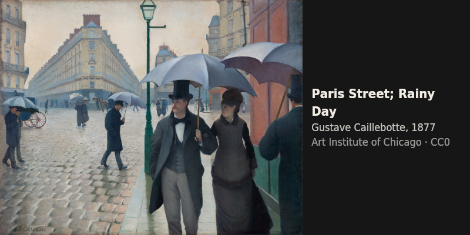
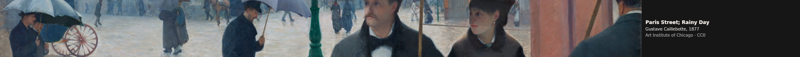

# kiosko-plugin-art

A work of art of the day on the panel: a public-domain painting, photograph or print from The Met, the Art Institute of Chicago, the Rijksmuseum or Taiwan's National Palace Museum, fitted to the tile's shape (whole on squarish ones, the most interesting band on long strips), with its title, artist, year, museum and credit always on screen. Also full screen, as an interlude. No keys needed.

A plugin for [Kiosko](https://github.com/kiosko-lcd/kiosko), the widget mosaic for small USB LCD panels.





## Install

In Kiosko, **Plugins → Install from npm** → `kiosko-plugin-art`, then restart Kiosko. Or from a terminal:

```sh
npm install --prefix ~/.config/kiosko/plugins kiosko-plugin-art
```

(macOS: `~/Library/Application Support/Kiosko/plugins`, Windows: `%APPDATA%\Kiosko\plugins`.)

## Requirements

- Internet access to the museum chosen (see *What it does on your machine*). No keys or accounts: The Met, the Art Institute of Chicago, the Rijksmuseum and the National Palace Museum all open their collections without one.

## What it does on your machine

- **Internet**: contacts `collectionapi.metmuseum.org`, `images.metmuseum.org`, `api.artic.edu`, `www.artic.edu`, `data.rijksmuseum.nl`, `iiif.micr.io`, `digitalarchive.npm.gov.tw`, `iiifod.npm.gov.tw`.

## Widgets

### Work of the day — `art/work`

A public-domain painting, photograph or print from a great museum, a different one each day, fitted to the tile: whole on squarish tiles, the most interesting band on long strips. Its title, artist, year, museum and licence are always on screen.


Uses: `art/today`.

| Option | Type | Default | |
|---|---|---|---|
| `fit` | `auto` \| `whole` \| `fill` | `"auto"` | Fit. By the tile’s shape: whole when it fills most of the tile, else the most interesting part of it (on a long strip, the best band). |
| `caption` | `auto` \| `panel` \| `overlay` | `"auto"` | Caption. Title, artist, year, museum and licence are always shown: the museums’ terms ask for the credit. |

## Data sources

### Work of the day — `art/today`

A public-domain work from a museum's open collection, the same all day (or for a few hours), changing at midnight. Kept on disk with its image, at the size the panels need: the museum is asked once a day. Read every 5 min while a widget uses it. Options are set once in Kiosko → Settings → Data sources.

| Option | Type | Default | |
|---|---|---|---|
| `provider` | `auto` \| `met` \| `aic` \| `rijks` \| `npm` | `"auto"` | Museum. Whose collection. All of them without a key; only public-domain and CC0 works are shown. |
| `kind` | `painting` \| `photograph` \| `print` \| `any` | `"painting"` | What. The National Palace Museum has paintings only. |
| `rotateMs` | duration (ms) | `0` | A new work every. 0: one a day, changing at midnight. 6 h: four a day (at 0:00, 6:00, 12:00 and 18:00). Whole hours. |

## Interludes

### Work of the day, full screen — `art/show`

Today's work over the whole panel for a few seconds, with a slow zoom towards its most interesting part (on a long strip, a slow scan along it), and its credit on screen. Add it in Kiosko → Screens → Interludes.

| Option | Type | Default | |
|---|---|---|---|
| `seconds` | number | `15` | Seconds |
| `motion` | boolean | `true` | Slow zoom or scan. Off: the work stands still. |

## Museums

Each museum is a module under `src/providers/` (how to pick one of its works
for a day, which hosts it uses, what its terms ask to show) and the source
picks one with its `provider` option. All four open their collections
without a key.

| `provider` | Museum | What | How |
|---|---|---|---|
| `met` | The Metropolitan Museum of Art, New York | Paintings (European Paintings), photographs, prints | Collection API: `/v1.1/search` (the old `/v1/search` was retired on 2026-10-01), then the object; images 600 px or the original |
| `aic` | Art Institute of Chicago | Paintings, photographs, prints | Public API (`/artworks/search`, sorted by id), then its IIIF server at 400–1686 px wide |
| `rijks` | Rijksmuseum, Amsterdam | Paintings, photographs, prints | New data services (no key; the old API that needed one answers 410 Gone): Linked Art search by period, the EDM record, the IIIF image |
| `npm` | National Palace Museum (國立故宮博物院), Taipei | Paintings (繪畫), up to 1911 | Its open-data site's search, then the work's IIIF manifest and image, at most a megapixel |

`auto` (the default) takes the National Palace Museum for a reader in
Traditional Chinese, and otherwise The Met, the Art Institute of Chicago
and the Rijksmuseum by turns, a different one each day.

## Licences and credit

Only works the museum marks as free to use are shown, and the credit is
always on screen: the title, the artist and date (as the museum writes
them, never translated), the museum and the licence. Where a tile has room
for one or two lines only, they take turns every 20 seconds; the interlude
shows them over the bottom of the picture all along.

| Museum | What is shown | Its terms |
|---|---|---|
| The Met | `isPublicDomain` objects only (only those have an image under Open Access). Credit: **The Met · Public domain** | Open Access data is CC0; images of public-domain works are free for any use. [metmuseum.github.io](https://metmuseum.github.io/), [Open Access](https://www.metmuseum.org/hubs/open-access) |
| Art Institute of Chicago | `is_public_domain` artworks only. Credit: **Art Institute of Chicago · CC0** | Data CC0 (but `description`, which isn't used), images of public-domain works CC0. Asks for an `AIC-User-Agent` header and for 843 px images (up to 1686 for public-domain works). [api.artic.edu/docs](https://api.artic.edu/docs/), [Image licensing](https://www.artic.edu/image-licensing) |
| Rijksmuseum | Images under the Public Domain Mark or CC0 only (`edmRights`). Credit: **Rijksmuseum · Public domain** (or CC0) | Free use, including commercial; it kindly asks to credit the Rijksmuseum. [Information and data policy](https://data.rijksmuseum.nl/policy/) |
| National Palace Museum | Paintings from before the Republic (1912), so public domain everywhere (the dynasty, a 民國 year or a year from 1912 rule a work out); images of at most a megapixel. Credit, as its terms give it: **The National Palace Museum, Taipei, CC BY 4.0 @ www.npm.gov.tw** (in Chinese: **國立故宮博物院，臺北，CC BY 4.0 @ www.npm.gov.tw**) after the title | Images up to 1 MP are CC0; up to 6 MP and the site's texts (titles), CC BY 4.0 with that attribution; "no application, any use, free of charge". [Open data statement](https://digitalarchive.npm.gov.tw/opendata/) |

No museum logo is used, and the plugin is not affiliated with or endorsed
by any of them. See NOTICE.

## The work of the day

- **The same all day, everywhere**: the pick depends only on the museum, the
  kind, the local date (on the machine's clock: it changes at local
  midnight, also on the 23- and 25-hour days) and, when rotating, the slot of
  the day (*A new work every*, in whole hours: 6 h gives four a day, at
  0:00, 6:00, 12:00 and 18:00). Two panels, or a restart, show the same work.
- **What suits a panel**: a work much longer or taller than 3.2 : 1 (a
  handscroll, a frieze) or smaller than 300 px is skipped for the next
  candidate, up to eight. The National Palace Museum photographs works with
  a colour chart, a grey ramp and a label at their edges: the work's own
  block is kept (the largest region apart from the neutral backdrop), and
  bands along its edges that are mostly neutral or pure patches of colour,
  with a ramp or three hues in them, are cut off. Painted silk and paper are
  tinted, so the work itself stays whole.
- **A picture, not what holds it**: frames, boxes, cases, album covers and
  bindings are left out by the museums' own data: the Met's object name and
  classification, the Art Institute's classifications (and, for paintings
  and photographs, a cover or binding in the title), the Rijksmuseum's
  object types. At the National Palace Museum an album, or a set of
  scrolls, as a whole (its leaves and parts are works of their own), and
  the pieces of its curio cabinets, are left out by their title and
  department before their record is asked for; of a work's photographs, its
  title and colophon pages are skipped, they are taken in the order they
  were photographed (some records list them backwards, the scroll rolled up
  first), and of a handscroll, whose first sections are often its silk
  wrapper and title and its last ones the colophons and box, the section a
  third of the way in is shown.
- **Politely**: once a work is in, the museum isn't asked again until the
  next day (or slot). Its record and image are kept in the plugin's data
  folder (the images of the last two works: a few hundred KB, a few MB for a Met original). How many works
  a search has is remembered for a week. If the museum is down, the last
  work stays on screen with *not updated* after the credit, and it is asked
  again after 5 minutes, then 10, 20… up to 3 hours, or when it says
  (`Retry-After`). Requests carry a User-Agent naming the plugin and Kiosko,
  never you.
- **No bigger than needed**: each tile notes its size, and the image is
  asked for at about the long edge of the largest one that showed it lately
  (480, 843, 1200, 1686 or 2048 px). A bigger panel added later means one
  more download, of the image alone, if the museum has it bigger. The Met
  offers only a 600 px image or the original (several MB), so above 600 px
  it is the original, shrunk on the machine.

## Fitting the work to the tile

- **Squarish tiles**: the whole work, on a background drawn from its own
  colours (its average colour, deepened), with the caption in the room it
  leaves beside or under it, or over its bottom edge when there is none.
- **Long strips** (a 1920×140 bar): the caption at the right and, in the
  rest, the most interesting band of the work: each row's local contrast
  (edges, texture, figures) and colour, summed, with flat areas (sky, wall,
  mount) counting little; the band with the highest total wins, the middle
  on a tie. Tall strips do the same with columns.
- *Fit* can force the whole work or a fill; *Caption* can put it always
  over the work, or make room for a panel.

## Interlude

*Work of the day, full screen* shows today's work over the whole panel for a
few seconds (15 by default) with a slow zoom towards its most interesting
part, or, on a long strip where only a band fits, a slow scan along it. The
credit stays at the bottom. It is skipped until there is a work.

## Taiwan and Chinese

The labels come in English, Spanish, German and Simplified and Traditional
Chinese; museum data stays as the museum gives it (the National Palace
Museum's titles are Chinese, with the English title when it gives one, for
readers in other languages). Its government open-data API
(`odapi.npm.gov.tw`, on data.gov.tw) has the same catalogue as JSON but did
not answer from outside Taiwan when this was written, so the plugin uses its
open-data site's own search. Works of the Republic (from 1912) are left
out, as they may still be in copyright outside Taiwan: a 民國 / 中華民國 /
近代 / 現代 period in the title or any field, a year of the Republic
(民國三十三年 is 1944) or a Gregorian year from 1912. Titles on the search
page are checked first, so such works are never even asked for.

## Development

```sh
npm install
npm test          # node:test
npm run check     # TypeScript
npm run build     # dist/index.js, what Kiosko loads
```

To try it in a running Kiosko without publishing: `kiosko plugins link .` and restart Kiosko.

Working on Kiosko and its plugins together: clone them side by side
(`kiosko/` and `kiosko-plugins/kiosko-plugin-art/`) and run `npm install` in
`kiosko/`; its workspaces link every plugin found in `../kiosko-plugins`.

## License

The code is MIT (see LICENSE). The works shown are the museums': public
domain or CC0, or CC BY 4.0 with the credit their terms ask for (see
*Licences and credit* above and NOTICE). The screenshots in `docs/` show
Gustave Caillebotte's *Paris Street; Rainy Day* (1877), Art Institute of
Chicago, CC0.
